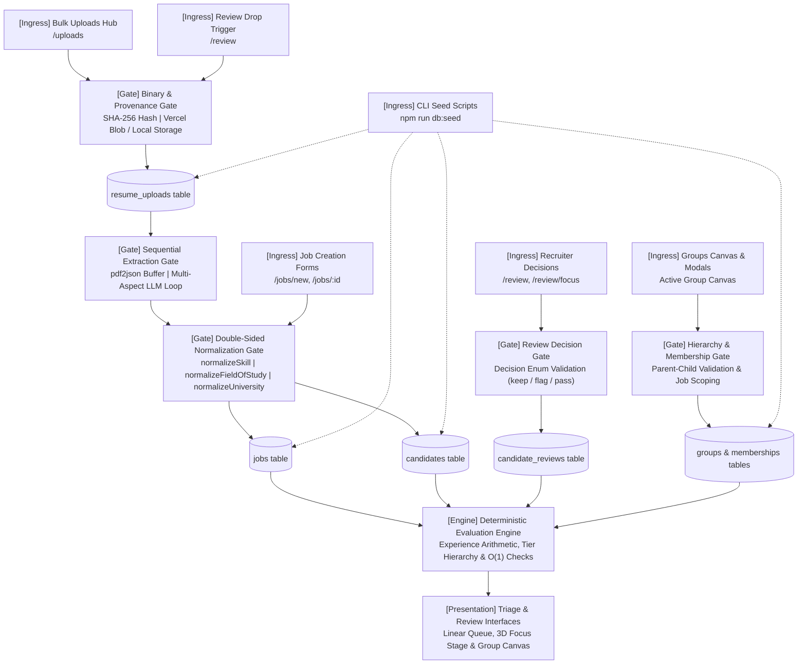
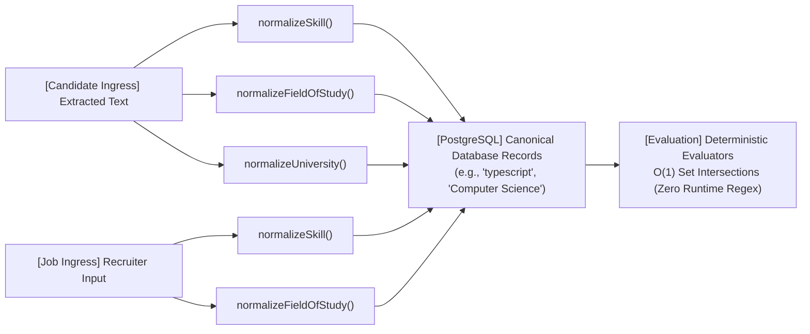

# Data Ingress & Flow Architecture

This document maps all the pathways through which external data enters HireFlow, the common validation and normalization gates that process it, and how it is persisted.

---

## 1. High-Level Ingress Topology

Data flows into HireFlow through five primary vectors: candidate documents, job specifications, recruiter triage decisions, candidate groupings, and development seed fixtures.

---

## 2. Ingress Vectors

### Vector 1: Candidate Documents (Resumes)
Candidate files (`.pdf`, `.txt`, `.md`) enter through two UI locations:
- **Bulk Uploads Hub** ([`/src/features/uploads/views/UploadsPage.tsx`](/src/features/uploads/views/UploadsPage.tsx)): Allows multi-file ingestion with live progress telemetry and feedback decks.
- **Review Drop Trigger** ([`/src/features/review/views/queue/ReviewQueuePage.tsx`](/src/features/review/views/queue/ReviewQueuePage.tsx)): Quick drag-and-drop directly into the active review queue, automatically bound to the currently viewed job.

Both entrypoints route through [`POST /api/resumes/upload`](/src/app/api/resumes/upload/route.ts), which offloads binary payloads before sequential extraction begins ([ADR 0006](/docs/adr/0006-resume-upload-sequential-extraction-architecture.md)).

### Vector 2: Job Specifications & Knockout Criteria
Recruiters configure role requirements (experience years, mandatory and preferred skills, minimum degree, budget bands, work mode, and notice periods):
- Handled through [`POST /api/jobs`](/src/app/api/jobs/route.ts) and [`PATCH /api/jobs/[id]`](/src/app/api/jobs/[id]/route.ts).
- Requirements pass through the shared normalization pipeline before database insertion.

### Vector 3: Recruiter Triage Decisions
Human recruiters sort candidates into triage states (`keep`, `flag`, `pass`, `pending`) with optional notes:
- Handled through [`POST /api/candidates/[id]/decision`](/src/app/api/candidates/[id]/decision/route.ts).
- Enforces unique `(candidate_id, job_id)` constraint via [`reviewsService`](/src/features/review/core/services/reviewsService.ts).

### Vector 4: Candidate Groups & Subgroups
Recruiters organize candidate pools into hierarchical segments (e.g., Fast-Clear, Logistics Exceptions):
- Handled through [`POST /api/groups`](/src/app/api/groups/route.ts).
- Persists parent-child group structures and candidate membership associations.

### Vector 5: Developer & Demo Seeding
Development environments and test harnesses inject pre-parsed profiles, jobs, upload provenance records, and group hierarchies:
- Handled through `npm run db:seed` and `npm run db:reset` via [`/src/db/seed.ts`](/src/db/seed.ts).
- Inserts data in strict foreign-key dependency order (`jobs` -> `candidates` -> `resume_uploads` -> `groups`).

---

## 3. Common Pathways & Processing Gates

### Gate 1: Binary & Provenance Gate
Every uploaded document passes through [`/src/lib/upload/`](/src/lib/upload/):
- **SHA-256 Hashing**: Calculates a deterministic cryptographic fingerprint of file bytes to prevent duplicate storage.
- **Binary Decoupling**: Stores the raw document in Vercel Blob storage (or `.uploads/resumes/` locally) to keep the primary PostgreSQL database free from large BLOBs.
- **Ingress Record Creation**: Registers a metadata record in `resume_uploads` via [`UploadsService`](/src/services/uploadsService.ts) with `status: "stored"`.

### Gate 2: Sequential Extraction Gate
To prevent LLM provider rate-limit and token exhaustion (OpenAI/Gemini TPM/RPM ceilings), extraction is executed as a controlled client-driven sequence:
- **Buffer-to-Text**: Converts raw PDF buffers into normalized plain text using `pdf2json`.
- **Structured Schema Extraction**: Runs multi-aspect extraction covering 7 schemas (`identity`, `work_history`, `education`, `skills_demonstrated`, `skills_declared`, `logistics`, `extraction_metadata`).
- **Telemetry Loop**: Emits step-by-step progress events back to the UI.

### Gate 3: Double-Sided Ingress Normalization Gate
To keep evaluation runtime fast ($O(1)$ lookups) and prevent false orphaned skill flags, normalization occurs symmetrically on both sides of the ingress boundary ([ADR 0005](/docs/adr/0005-double-sided-ingress-normalization-architecture.md)):

- **Skills Normalization**: Collapses aliases, punctuation, and capitalization (e.g., `NodeJS`, `node.js`, `Node` -> `node.js`) via [`normalizeSkill`](/src/features/extraction/skillNormalizer.ts).
- **Field of Study Normalization**: Maps diverse degree titles to standard disciplines via [`normalizeFieldOfStudy`](/src/features/extraction/fieldOfStudyNormalizer.ts).
- **University Normalization**: Two-tier resolution against 136 HEC institutions (Tier 1: $O(1)$ exact dictionary match; Tier 2: Token-sorted Levenshtein distance fallback) via [`normalizeUniversity`](/src/features/extraction/universityNormalizer.ts).

### Gate 4: Relational Authority Gate
All validated and normalized payloads terminate in PostgreSQL through Drizzle ORM:
- **Inferred Types**: TypeScript models are inferred directly from table definitions (`$inferSelect`, `$inferInsert`) to prevent model drift.
- **Provenance Link**: Candidate records link back to `resume_uploads` via `candidateId` and `pdf_url`.

---

## 4. Relationship to Other Documentation

- [ADR 0001](/docs/adr/0001-two-layer-extraction-and-query-pipeline.md): Two-layer extraction and query pipeline.
- [ADR 0003](/docs/adr/0003-drizzle-schema-authority-and-downward-dependencies.md): Drizzle schema authority and layer dependency rules.
- [ADR 0005](/docs/adr/0005-double-sided-ingress-normalization-architecture.md): Symmetrical double-sided normalization theory.
- [ADR 0006](/docs/adr/0006-resume-upload-sequential-extraction-architecture.md): Two-stage binary storage and sequential extraction design.
- [System Architecture](/docs/ARCHITECTURE.md): Comprehensive system layers, UI paradigms, and component breakdown.
