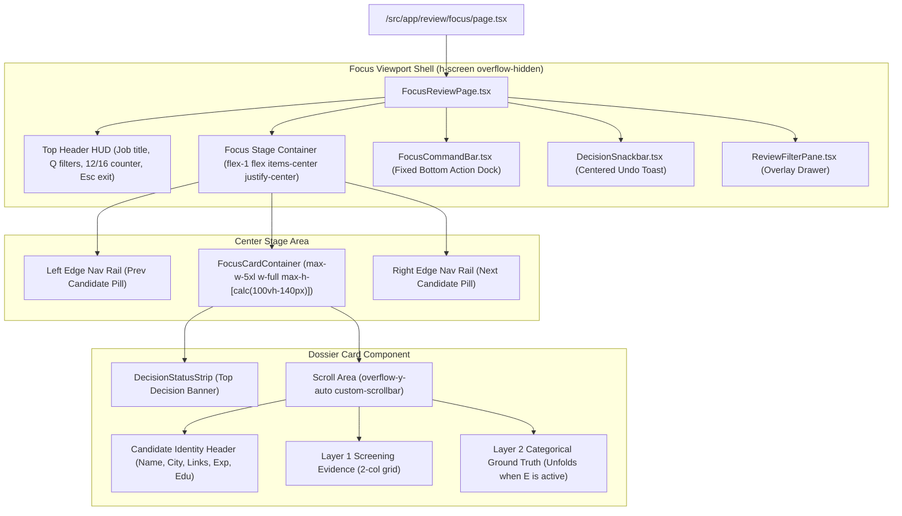

# UI/UX Redesign Plan: HireFlow Focus Mode (`/review/focus`)

This document defines the architectural and visual redesign of HireFlow's Focus Mode (`/review/focus`). It addresses the usability and layout issues identified in the reference screenshots and provides a concrete, step-by-step implementation blueprint tailored for execution by **Gemini 3.8 Flash**.

---

## 1. Problem Diagnosis & Current-State Analysis

### What the Screenshots Show:

1. **Aspect Ratio Distortion (The "Vertical Rectangle" Phone Look - Image #1)**
   - In collapsed mode, the active candidate card is artificially constrained to `max-w-2xl` (672px).
   - Because candidate profiles contain substantial data (identity, links, role, verified experience, education capsule, and four evidence categories), forcing this content into 672px creates a tall, narrow vertical pillar. On desktop screens (1080p/1440p), it looks like an oversized mobile screen floating in empty space rather than an expansive professional dashboard.

2. **Abrupt Layout Shift on Evidence Expansion (Image #2)**
   - When the reviewer toggles evidence (`E`), the container abruptly flips from `max-w-2xl` (672px) to `max-w-5xl` (1024px), and the vertical alignment toggles from `items-center py-4` to `items-stretch py-0`.
   - This causes side elements to bounce, card margins to violently reflow, and breaks visual continuity.

3. **Complete Absence of Scrolling (Content Clipping - Image #2)**
   - When Layer 2 ground truth opens, the vertical content exceeds the available screen height.
   - Because `FocusReviewPage.tsx` sets `overflow-hidden` on both the root container and `<main>`, and the card wrapper in `SpatialFocusDeck.tsx` lacks height boundaries or scroll targets, content below the fold is cut off with no scrollbar. Reviewers cannot inspect full work history, compensation, or logistics details.

4. **Clunky "3D Side Cards" Illusion**
   - The pseudo-3D side cards (`CandidateSideCard`) are scaled down to `0.84`, pushed to the screen margins, and clipped half-visible.
   - They consume horizontal margins while providing zero actionable utility, giving the page an unpolished, glitchy appearance.

---

## 2. Target Design Concept: The "Wide Cinematic Dossier"

Instead of an unstable 3D carousel with shifting widths, Focus Mode will be rebuilt around a **stable, generous desktop canvas** with a dedicated internal scroll viewport and sleek edge navigation rails.

```
+---------------------------------------------------------------------------------------------------+
| [HireFlow Focus: Senior Full Stack Engineer]  [Filters (Q)]          [12/16] [K 10 | F 2 | P 2] [X]|
|===================================================================================================|
|                                                                                                   |
|  [< Prev]       +---------------------------------------------------------------+       [Next >]  |
|  Muhammad S.    | [Kept · 12 hr ago]                                            |       Jane Doe  |
|  (ArrowLeft)    | ------------------------------------------------------------- |       (ArrowR)  |
|                 | Muhammad Ghulam Jillani   [Lahore]   [Links]                  |                 |
|                 | AI Data Scientist Mentor • 2 yrs exp • mock_resume_a.pdf      |                 |
|                 | BS Artificial Intelligence • Institute of Mgmt Sciences      |                 |
|                 | ------------------------------------------------------------- |                 |
|                 | SCREENING EVIDENCE                          [Evidence Details]|                 |
|                 | Column 1: Experience & Skills    Column 2: Edu & Logistics   |                 |
|                 | [2/5 yrs exp]                    [BS Computer Science]        |                 |
|                 | [+6 unstated]                    [All logistics satisfied]    |                 |
|                 | ------------------------------------------------------------- |                 |
|                 | (When Layer 2 is expanded, unfolds here inside scroll area)   |                 |
|                 | Work History Breakdown, Verbatim Quotes, etc.                 |                 |
|                 | [Smooth, natural custom-scrollbar inside the dossier]         |                 |
|                 +---------------------------------------------------------------+                 |
|                                                                                                   |
|===================================================================================================|
| [Kept · 12 hr ago]        [A Keep]   [F Flag]   [R Pass]   [U Clear]   [E Evidence]        [Z Undo]   |
+---------------------------------------------------------------------------------------------------+
Stable max-w-5xl width throughout. 16:9 / landscape card proportions. Smooth internal scrolling.
Clean floating edge navigation pills replace clipped ghost cards.
```

### Key Architectural Pillars

1. **Fixed, Stable Card Width (`max-w-5xl` / 1024px)**
   - The dossier card maintains the exact same `max-w-5xl` width whether evidence is collapsed or expanded.
   - In collapsed mode, the 1024px width spreads out candidate details and Layer 1 screening evidence across two or three balanced columns, establishing an elegant ~16:9 card aspect ratio (wide and compact rather than tall and skinny).
   - In expanded mode, Layer 2 expands within the exact same boundaries with zero horizontal jitter.

2. **Dedicated Internal Dossier Scroll Container**
   - The top header HUD and bottom command bar remain fixed at the viewport extremes (`h-14` / `h-16`).
   - The central dossier card is bounded by `max-h-[calc(100vh-140px)] flex flex-col`.
   - The card's header (name, location, status banner) remains pinned at the top of the card.
   - The card's content area features `overflow-y-auto custom-scrollbar`, ensuring full scrollability down through Layer 2 evidence without clipping.

3. **Replacing Pseudo-3D Side Cards with Sleek Floating Edge Rails**
   - Eliminate `CandidateSideCard` and the clipped offscreen transforms.
   - Introduce lightweight floating navigation pills at the screen edges:
     - **Left rail:** Floating pill displaying `[←] Prev: [Candidate Name]` (with status dot).
     - **Right rail:** Floating pill displaying `Next: [Candidate Name] [→]` (with status dot).
   - When transitioning between candidates, use a hardware-accelerated horizontal slide animation (`x: 30 -> 0`, `opacity: 0 -> 1`), preserving the kinetic feel of a deck without visual clutter.

4. **Clean Command Bar Dock (Resolving Bottom-Left Overlap)**
   - Restructure `FocusCommandBar.tsx` with defined flex sections and safe-area margins so that status badges, decision buttons, and keyboard hints do not collide or overlap with browser/dev overlays.

---

## 3. Component Architecture & Data Flow



---

## 4. Detailed Component Specifications

### 4.1. `FocusReviewPage.tsx` (Viewport Orchestrator)
- **Path:** `/src/features/review/views/focus/FocusReviewPage.tsx`
- **Role:** Main full-screen viewport container (`h-screen w-screen overflow-hidden bg-surface flex flex-col justify-between`).
- **Layout changes:**
  - Remove dynamic class switching on `<main>` (`py-0 items-stretch` vs `py-4 items-center`). Keep `<main>` centered and consistently padded: `relative flex-1 min-h-0 w-full flex items-center justify-center px-4 sm:px-8 py-3 overflow-hidden`.
  - Maintain the top-left HUD (Job Title, `Filters (Q)` button) and top-right HUD (Position counter `12 / 16`, totals, Exit focus button).
  - Extract previous and next candidate references from `filteredQueue` and pass them to the deck.

### 4.2. `SpatialFocusDeck.tsx` (Dossier Deck & Edge Rails)
- **Path:** `/src/features/review/views/focus/components/SpatialFocusDeck.tsx`
- **Role:** Houses the central dossier card and edge navigation rails.
- **Key specifications:**
  1. **Width & Height:**
     ```tsx
     <div className="relative w-full max-w-5xl h-full max-h-[calc(100vh-148px)] flex flex-col rounded-2xl border border-outline-variant/60 shadow-xl bg-surface overflow-hidden">
     ```
  2. **Motion transitions:**
     - Replace the `offsetDistance` calculation and multi-card render loop with a single active card wrapped in `AnimatePresence mode="popLayout"`.
     - Animate directionally based on navigation direction (`direction === "next" ? { x: 30, opacity: 0 } : { x: -30, opacity: 0 }`).
  3. **Edge Navigation Controls:**
     - Positioned absolutely at `left-3 sm:left-6` and `right-3 sm:right-6` inside the stage.
     - **Left button:**
       ```tsx
       {hasPrev && (
         <button
           type="button"
           onClick={onPrev}
           className="group flex items-center gap-2 px-3 py-2 rounded-xl bg-surface-container/90 hover:bg-surface-container-high border border-outline-variant/40 shadow-md text-xs font-semibold text-on-surface transition-all cursor-pointer"
           title="Previous candidate (ArrowLeft)"
         >
           <ChevronLeft className="h-4 w-4 text-on-surface-variant group-hover:text-primary transition-colors" />
           <div className="hidden xl:flex flex-col text-left">
             <span className="text-[9px] uppercase font-mono text-on-surface-variant">Prev (←)</span>
             <span className="text-xs font-bold text-on-surface truncate max-w-[120px]">{prevCandidateName}</span>
           </div>
         </button>
       )}
       ```
     - **Right button:**
       ```tsx
       {hasNext && (
         <button
           type="button"
           onClick={onNext}
           className="group flex items-center gap-2 px-3 py-2 rounded-xl bg-surface-container/90 hover:bg-surface-container-high border border-outline-variant/40 shadow-md text-xs font-semibold text-on-surface transition-all cursor-pointer"
           title="Next candidate (ArrowRight / Space)"
         >
           <div className="hidden xl:flex flex-col text-right">
             <span className="text-[9px] uppercase font-mono text-on-surface-variant">Next (→)</span>
             <span className="text-xs font-bold text-on-surface truncate max-w-[120px]">{nextCandidateName}</span>
           </div>
           <ChevronRight className="h-4 w-4 text-on-surface-variant group-hover:text-primary transition-colors" />
         </button>
       )}
       ```

### 4.3. Dossier Card Internal Scroll Structure
- **Path:** Inside `/src/features/review/core/components/card/CandidateCard.tsx`
- **Key specifications:**
  ```tsx
  <div className="flex flex-col h-full w-full overflow-hidden">
    {/* Pinned Top Banner */}
    <DecisionStatusStrip
      decision={item.decision}
      decidedAt={item.decidedAt}
      previousDecision={item.previousDecision}
      syncStatus={item.syncStatus}
      onClearDecision={onClearDecision}
      onRetrySync={onRetrySync}
      isCommitting={isCommitting}
    />

    {/* Scrollable Dossier Body with Custom Scrollbar */}
    <div className="flex-1 overflow-y-auto custom-scrollbar p-6 space-y-4">
      {/* 1. Candidate Identity & Profile Header */}
      <div className="flex items-start justify-between gap-4">
        ...
      </div>

      {/* 2. Layer 1 Screening Evidence (2-column layout) */}
      <div className="p-4 rounded-2xl bg-surface-container space-y-3">
        <div className="flex items-center justify-between pb-2 border-b border-outline-variant/30">
          <span className="text-[11px] font-bold uppercase tracking-wider text-on-surface-variant">
            Screening Evidence
          </span>
          <Button
            variant="ghost"
            size="sm"
            onClick={onToggleEvidence}
            className="h-7 px-2.5 gap-1.5 text-xs font-bold rounded-xl bg-surface-container-high hover:bg-surface-container-highest text-on-surface border-0 transition-colors"
          >
            <Eye className="h-3.5 w-3.5 shrink-0" />
            <span>{isEvidenceOpen ? "Hide" : "Evidence"}</span>
            {isEvidenceOpen ? <ChevronUp className="h-3 w-3" /> : <ChevronDown className="h-3 w-3" />}
          </Button>
        </div>

        <BlockingStrip
          experience={item.experience}
          skills={item.skills}
          education={item.education}
          logistics={item.logistics}
        />
      </div>

      {/* 3. Layer 2 Categorical Ground Truth (Rendered directly in scroll flow when open) */}
      <AnimatePresence>
        {isEvidenceOpen && (
          <motion.div
            initial={{ opacity: 0, height: 0 }}
            animate={{ opacity: 1, height: "auto" }}
            exit={{ opacity: 0, height: 0 }}
            transition={{ duration: 0.2 }}
          >
            <EvidenceDrawer item={item} onClose={onToggleEvidence} />
          </motion.div>
        )}
      </AnimatePresence>
    </div>
  </div>
  ```

### 4.4. `FocusCommandBar.tsx` (Bottom Command Dock)
- **Path:** `/src/features/review/views/focus/components/FocusCommandBar.tsx`
- **Improvements:**
  - Set `h-14 sm:h-16 shrink-0 bg-surface-container-lowest/95 dark:bg-[#090d16]/95 backdrop-blur-md border-t border-outline-variant/30 px-6 sm:px-8`.
  - Fix the left-side text overlap by ensuring `pl-2` and `min-w-[160px]`.
  - Action buttons grouped in center: `[A] Keep`, `[F] Flag`, `[R] Pass`, `[U] Clear`, `[E] Evidence`.
  - Right-side `[Z] Undo` button gracefully reveals when `canUndo` is true.

---

## 5. Step-by-Step Implementation Guide for Gemini 3.8 Flash

Follow this sequential checklist to execute the redesign:

### Step 1: Update Stage Geometry in `FocusReviewPage.tsx`
1. Open `/src/features/review/views/focus/FocusReviewPage.tsx`.
2. Locate the `<main>` tag around line 233.
3. Replace the dynamic class switching (`${isEvidenceOpen ? "py-0 items-stretch" : "py-4 items-center"}`) with static, balanced centering:
   ```tsx
   <main className="relative flex-1 min-h-0 w-full flex items-center justify-center px-4 sm:px-8 py-3 overflow-hidden">
   ```
4. Extract previous and next candidate references from `filteredQueue` based on `activeIndex`:
   ```tsx
   const prevItem = activeIndex > 0 ? filteredQueue[activeIndex - 1] : null;
   const nextItem = activeIndex < totalCandidates - 1 ? filteredQueue[activeIndex + 1] : null;
   ```
5. Pass `prevItem` and `nextItem` to the center deck component.

### Step 2: Redesign `SpatialFocusDeck.tsx` into a Centered Deck with Edge Rails
1. Open `/src/features/review/views/focus/components/SpatialFocusDeck.tsx`.
2. Eliminate the multi-card render loop that creates the scaled, clipped side cards (`offsetDistance`, `getCardVariants`).
3. Replace the stage markup with:
   - A single centered card wrapper: `w-full max-w-5xl h-full max-h-[calc(100vh-148px)] flex flex-col rounded-2xl border border-outline-variant/50 shadow-xl bg-surface overflow-hidden`.
   - Left and right edge navigation buttons positioned with `absolute top-1/2 -translate-y-1/2` displaying previous/next candidate names.
4. Pass `isLayer2Expanded={isEvidenceOpen}`, `onToggleLayer2={onToggleEvidence}`, and `expandedFullHeight={false}` to `CandidateCard`.

### Step 3: Ensure Scroll Container Continuity in `CandidateCard.tsx`
1. Open `/src/features/review/core/components/card/CandidateCard.tsx`.
2. Inspect the root `<Card>` wrapper.
3. In Focus Mode (or when card container is constrained in height), ensure:
   - The card container has `flex flex-col h-full overflow-hidden`.
   - The content wrapper below `<DecisionStatusStrip>` has `flex-1 overflow-y-auto custom-scrollbar p-6 space-y-4`.
4. Verify that when `EvidenceDrawer` renders within `CandidateCard`, it resides inside the scrollable container so users can freely scroll to the bottom.

### Step 4: Polish `FocusCommandBar.tsx` Layout
1. Open `/src/features/review/views/focus/components/FocusCommandBar.tsx`.
2. Ensure the footer has `h-14 sm:h-16 shrink-0` and safe horizontal padding (`px-6`).
3. Verify that the left status segment has `min-w-[160px]` and clean font sizing to prevent overlap with floating elements.

### Step 5: Verification & Safety
1. Run TypeScript check: `npm run type-check`.
2. Run ESLint targeted on the updated files to ensure zero warnings.
3. Verify keyboard shortcuts:
   - `ArrowLeft` / `ArrowRight`: Moves between candidates with directional sliding.
   - `A` / `Space`: Keep.
   - `F`: Flag.
   - `R`: Pass.
   - `E`: Toggles evidence drawer without changing card width.
   - Mouse wheel / touch scroll inside card: Scrolls effortlessly through all Layer 2 evidence without clipping.
   - `Esc`: Exits focus mode back to `/review`.

---

## 6. Verification Checklist

- [ ] Card maintains identical `max-w-5xl` width before and after opening evidence.
- [ ] No clipped, half-visible cards stuck to screen margins in collapsed mode.
- [ ] Dossier card features a true landscape card aspect ratio (~1024px by ~500px in collapsed mode).
- [ ] Layer 2 ground truth evidence scrolls smoothly down to the last item.
- [ ] Edge navigation rails provide clear, clickable `Prev` and `Next` affordances with candidate names.
- [ ] Bottom command dock buttons remain accessible and unclipped.
- [ ] Zero automated tests created or executed (per project testing policy).
- [ ] No production build or verification suite run without approval (per workflow policy).
- [ ] No emojis in code or UI (per project design policy).
