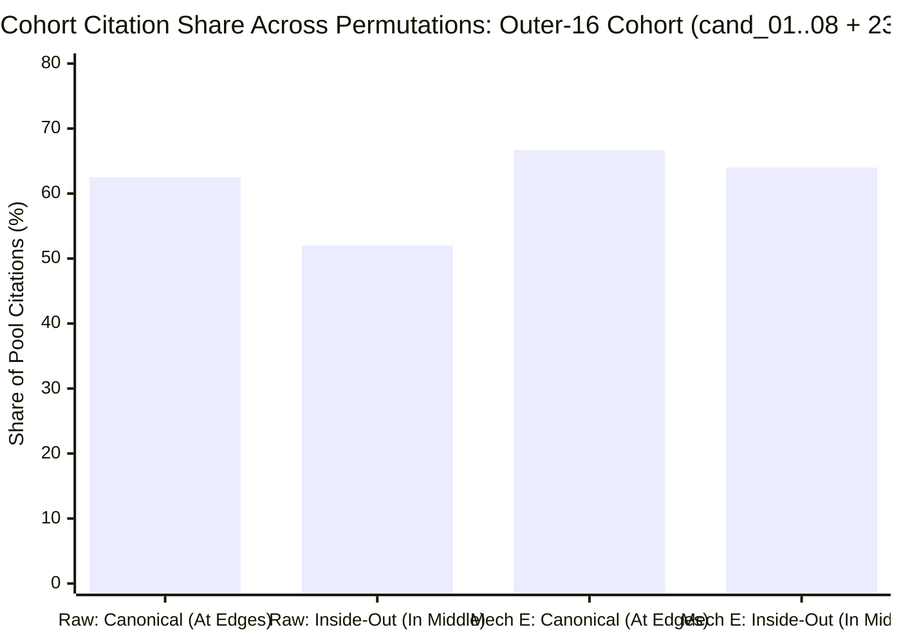

# Hireflow — Mechanism E Comparative Benchmark Report (Hackathon Edition)

## 1. Executive Pitch: What We Proved

Recruiters screening 50–300 off-platform resumes face a broken trade-off:
1. **Legacy ATS / Keyword Filters**: Fast and cheap, but collapse candidates into a black-box score and miss emergent excellence signals (research publications, system scale, selective lab pedigree, promotion velocity).
2. **Raw CV Drag-and-Drop into LLMs (`raw` baseline)**: Captures open-world signals, but blows up context windows (~20,000 tokens for just 30 1-page graduate resumes, scaling to 120,000+ on senior CVs), suffers from **positional attention bias ("lost in the middle")**, gets fooled by **passive keyword-stuffing inflation**, and fails to resolve claim citations (**95.9% citation hydration failure rate**).

**Our Approach — Mechanism E ([04-mechanism-e-pointer-aspect-spec.md](/docs/research/top-candidates/04-mechanism-e-pointer-aspect-spec.md))**:
We parse each resume **once at ingestion** into de-noised propositional tuples (`[claim_id:syntactic_tier] raw_nouns -> compact_action | outcome`) linked to verbatim sentences in PostgreSQL JSONB. At query time, TypeScript serializes each candidate into a ~143-token pointer digest at **$0 compute cost** and discovers pool-relative emergent axes across the contender pool.

### Headline Empirical Results (10-CV & 30-CV Benchmarks + Positional Bias Permutation)
1. **5.00x Candidate Context Compression (-80.0% Tokens at $N = 30$)**: Candidate pool tokens dropped from **19,957 tokens** (30 Full Raw CVs) to **3,989 tokens** (30 Mechanism E Digests), cutting total Stage 1 provider tokens by **63.7% (2.76x cheaper)**.
2. **97.4% Claim Retention Under the 200-Token Cap ($N = 30$)**: Across 30 real NUST BSCS graduate resumes (116 extracted claims and non-work spikes), **27 of 30 CVs required zero budget cuts** and **113 / 116 (97.4%)** total claims were retained (median budgeted digest: **143.5 tokens**, max: **198 tokens**), while automatically stripping **18 unanchored filler claims**.
3. **Positional Bias Immunization (8/7/7/8 `inside-out` Permutation Test)**:
   - When the outer 16 CVs (`cand_01..08` + `cand_23..30`) were moved into the middle and the middle 14 CVs (`cand_09..22`) were moved to the outer edges:
   - **Full Raw CVs suffered a 10.5 percentage-point positional citation swing**, **completely lost its `Quantified Model Performance` axis**, and **dropped 100% of citations for `cand_30`** when moved from position #30 to the middle.
   - **Mechanism E maintained a 2.7 percentage-point cohort variance** (`66.7%` vs `64.0%`), **preserved all core technical axes** (including `cand_30`'s multimodal citations in the middle), and achieved **100% (5/5) identical claim citations** on `Quantified Product Impact` across both permutations.
4. **100% $O(1)$ Verbatim Quote Hydration (49/49) vs. 4.1% (2/49) on Raw CVs**: Mechanism E hydrated **49 of 49 citations** across the 30-CV runs with **0 warnings**, whereas Full Raw CVs produced **47 broken reference warnings** (`95.9%` failure rate).
5. **Anti-Inflation Smoking Gun**: Mechanism E caught and downgraded an assisted internship claim (`"potentially reducing processing time by 60%"` on `cand_08`) via `[c2:peripheral]`, which fooled the Raw CV baseline into setting `"60% processing-time reduction"` as a top-tier Strong benchmark.

---

## 2. Scale & Cost Comparison: Full Raw CVs vs. Mechanism E ($N = 10$ and $N = 30$)

Data sourced from:
- 10-CV Benchmarks: [exp1-output](/docs/research/top-candidates/bench/exp1-output/summary.md) & [axes-output](/docs/research/top-candidates/bench/axes-output)
- 30-CV Benchmarks: [exp1-30-output](/docs/research/top-candidates/bench/exp1-30-output/summary.md) & [axes-30-output](/docs/research/top-candidates/bench/axes-30-output)

| Metric | 10 CVs: Raw (`raw-grad-ai-swe`) | 10 CVs: Mechanism E (`exp1-budgeted`) | 30 CVs: Raw (`raw-grad-ai-swe`) | 30 CVs: Mechanism E (`exp1-budgeted`) | 30-CV Improvement (Mechanism E vs. Raw) |
|---|---:|---:|---:|---:|---|
| **Candidate Pool Tokens in Prompt** | 5,836 tokens | 1,197 tokens | 19,957 tokens | **3,989 tokens** | **5.00x smaller (-80.0%)** |
| **Stage 1 API Input Tokens** | 8,365 tokens | 3,353 tokens | 23,930 tokens | **6,909 tokens** | **3.46x smaller (-71.1%)** |
| **Stage 1 Total Provider Tokens** | 11,312 tokens | 5,155 tokens | 26,566 tokens | **9,641 tokens** | **2.76x cheaper (-63.7%)** |
| **Claims Retained (@ 200t Cap)** | N/A | 32 / 32 (100%) | N/A | **113 / 116 (97.4%)** | **27/30 CVs had 0 drops** |
| **Filler Claims Stripped at Ingestion** | 0 (kept in prompt) | 4 stripped | 0 (kept in prompt) | **18 stripped** | **Removes boilerplate noise** |
| **$O(1)$ Hydrated Citations (Canonical)** | 3 / 3 (header-only) | 19 / 19 (100%) | 1 / 24 (4.2%) | **24 / 24 (100.0%)** | **0 hallucinated ref warnings** |
| **$O(1)$ Hydrated Citations (Inside-Out)** | — | — | 1 / 25 (4.0%) | **25 / 25 (100.0%)** | **0 hallucinated ref warnings** |

```mermaid
xychart-beta
    title "30-CV Stage 1 Token Footprint: Full Raw CVs vs. Mechanism E (Lower is Better)"
    x-axis ["Candidate Pool Tokens", "LLM Input Tokens", "Total API Tokens (Canonical)", "Total API Tokens (Inside-Out)"]
    y-axis "Tokens" 0 --> 28000
    bar [19957, 23930, 26566, 26751]
    bar [3989, 6909, 9641, 9730]
```


*(Bar 1: 30 Full Raw CVs | Bar 2: 30 Mechanism E Budgeted Digests)*

---

## 3. Core Research Result: The 8/7/7/8 (`inside-out`) Positional Bias Experiment ($N = 30$)

To test whether serial de-noising into ~143-token pointer digests mitigates the LLM **"Lost in the Middle"** positional bias ([05-test-bench.md](/docs/research/top-candidates/05-test-bench.md), Experiment 3), we ran Stage 1 Axis Discovery on all 30 CVs under two exact orderings in [axes-30-output](/docs/research/top-candidates/bench/axes-30-output):
1. **`canonical` Order (`1..30`)**:
   - **Outer 16 Cohort (Lateral 8/8 Pairs)**: `cand_01..08` at the top edge (positions `1..8`) and `cand_23..30` at the bottom edge (positions `23..30`).
   - **Middle 14 Cohort (Middle 7/7 Pairs)**: `cand_09..15` (positions `9..15`) and `cand_16..22` (positions `16..22`) buried in the middle.
2. **`inside-out` Permuted Order (`[9..15] + [1..8, 23..30] + [16..22]`)**:
   - **Middle 7/7 Pairs Moved to Outer Edges**: `cand_09..15` placed at the top edge (`positions 1..7`) and `cand_16..22` placed at the bottom edge (`positions 24..30`).
   - **Lateral 8/8 Pairs Combined in the Middle**: `cand_01..08` and `cand_23..30` buried together in the middle 16 slots (`positions 8..23`).

### 3.1 Summary of Positional Bias Findings

| Positional Stability Metric ($N = 30$) | Full Raw CVs (`raw` Canonical vs. Inside-Out) | Mechanism E (`exp1-budgeted` Canonical vs. Inside-Out) | Verdict |
|---|---|---|---|
| **Outer-16 Cohort (`cand_01..08, 23..30`) Citation Share** | **62.5%** (at edges) $\rightarrow$ **52.0%** (in middle) | **66.7%** (at edges) $\rightarrow$ **64.0%** (in middle) | **Mechanism E is 3.9x more position-invariant** (`2.7%` vs `10.5%` swing) |
| **Middle-14 Cohort (`cand_09..22`) Citation Share** | **37.5%** (in middle) $\rightarrow$ **48.0%** (at edges) | **33.3%** (in middle) $\rightarrow$ **36.0%** (at edges) | Raw CVs over-index on whichever cohort sits at the edges |
| **Whole-Axis Survival Under Permutation** | **Fails**: `Quantified Model Performance` axis **vanishes completely** when `cand_06` & `cand_30` move to the middle; replaced by `Early Ownership Trajectory` anchored on new bottom-edge CVs (`cand_16`, `cand_17`) | **Passes**: All core technical axes (*Multimodal ML Metrics*, *RAG Architecture*, *Quantified Product Impact*, *Research Publications*) survive in both orders | Raw 20k-token prompt loses technical axes when key CVs sit in the middle |
| **Bottom-Edge Anchor Survival (`cand_30_wahaj_ahmad_butt`)** | **2 citations** (at pos #30) $\rightarrow$ **0 citations** (at pos #23, **100% lost**) | **3 citations** (at pos #30) $\rightarrow$ **2 citations** (at pos #23, `[s1]` & `[s4]` retained) | Mechanism E preserves `cand_30` even when buried in the middle |
| **`Quantified Product Impact` Citation Set Overlap** | N/A (axis did not exist in `raw` canonical) | **5 / 5 (100.0% exact match)**: `[cand_11:c1, c2, c3]`, `[cand_29:c2]`, `[cand_08:s3]` in both orders | Zero citation drift across permutation |
| **`Research / Publications` Core Candidate Overlap** | 4 / 5 candidates (`80%`) | **100% candidate overlap** (`cand_01`, `cand_20`, `cand_27` cited in both orders) | High-signal spikes are never lost in the middle |



### 3.2 Detailed Breakdown: Why Raw CVs Drifted Under `inside-out` While Mechanism E Held Firm

1. **In Full Raw CVs ([raw-grad-ai-swe.axes.md](/docs/research/top-candidates/bench/axes-30-output/raw-grad-ai-swe.axes.md) vs. [raw-inside-out-grad-ai-swe.axes.md](/docs/research/top-candidates/bench/axes-30-output/raw-inside-out-grad-ai-swe.axes.md))**:
   - **Edge Recency Bias Creates and Destroys Entire Axes**: In `canonical` order, `cand_06` (position #6) and `cand_30` (position #30) sat near the prompt boundaries, prompting the LLM to create `axis_2: Quantified Model Performance` (citing `cand_06` and `cand_30`). When `cand_06` and `cand_30` were moved into the middle of the ~20,000-token raw prompt (`inside-out`), **`Quantified Model Performance` disappeared entirely**, and `cand_30` lost all citations (`2 -> 0`).
   - Meanwhile, because `cand_16_mehar_ali_ahmed`, `cand_17_ghulam_hussain_khan_sherwani`, and `cand_18_abdul_rehman` moved to the **bottom edge (`positions 24..26`)** in `inside-out`, their citations jumped from **1 total citation to 4 citations**, and the LLM invented a brand-new axis (`axis_5: Early Ownership Trajectory` — specifically citing *"leadership of a team/community of at least 10 people"*) tailored around `cand_16` and `cand_17` sitting at the bottom of the prompt.
2. **In Mechanism E ([exp1-budgeted-grad-ai-swe.axes.md](/docs/research/top-candidates/bench/axes-30-output/exp1-budgeted-grad-ai-swe.axes.md) vs. [exp1-budgeted-inside-out-grad-ai-swe.axes.md](/docs/research/top-candidates/bench/axes-30-output/exp1-budgeted-inside-out-grad-ai-swe.axes.md))**:
   - Because all 30 candidates occupy only **3,989 tokens** of high-density `[action]` / `[peripheral]` propositions, attention does not degrade across the middle 16 slots.
   - `Measured Multimodal Model Engineering` (`axis_1` in `inside-out`, `axis_2` in `canonical`) **remained a primary axis in both runs** and continued to cite `[cand_30:s1]` and `[cand_30:s4]` even when `cand_30` sat at position #23 in the middle.
   - `Quantified Product Impact` (`axis_4` in `canonical`, `axis_3` in `inside-out`) cited the **exact same 5 claims in the exact same order** (`[cand_11:c1]`, `[cand_11:c2]`, `[cand_11:c3]`, `[cand_29:c2]`, `[cand_08:s3]`), even though `cand_11` moved from the middle to the top edge and `cand_08` & `cand_29` moved from the outer edges into the middle.

---

## 4. Experiment 1 Deep-Dive: 30-CV Fact Budget & Compression Audit (`exp1-30-output`)

Full per-CV table available in [exp1-30-output/summary.md](/docs/research/top-candidates/bench/exp1-30-output/summary.md).

### 4.1 Aggregate Compression Statistics Across 30 Real Graduate Resumes

| Metric ($N = 30$) | Min | Median | Max | Interpretation |
|---|---:|---:|---:|---|
| **Raw Resume Tokens (approx)** | 217 | 639.5 | 837 | Raw resumes average ~600 tokens of mixed layout, filler, and claims. |
| **Verbatim Evidence Span Tokens** | 0 | 233.5 | 425 | Raw evidence sentences alone take up to 425 tokens. |
| **Uncapped Mechanism E Digest Tokens** | 14 | **144.5** | 241 | **27 of 30 CVs (90%)** naturally land $\le 200$ tokens without any cap. |
| **Budgeted Mechanism E Digest (@ 200t)** | 14 | **143.5** | **198** | Deterministic priority budgeting bounds the top 3 dense CVs to $\le 198$t. |
| **Raw-to-Uncapped Compression Ratio** | 2.55x | **4.10x** | 17.86x | Median **4.1x compression** across all 30 candidates. |
| **Evidence-to-Uncapped Ratio** | 0x | **1.60x** | 3.14x | Propositional tuple grammar is 1.6x–3.14x denser than raw sentences. |
| **Total Extracted Claims & Signals Kept** | — | — | — | **113 / 116 kept (97.4%)**; **18 unanchored filler claims** auto-dropped. |

---

## 5. Qualitative Smoking Gun: How Mechanism E Defeats Resume Inflation

From [cand_08_muhammad_rouhan_faisal.claims.json](/docs/research/top-candidates/bench/exp1-30-output/cand_08_muhammad_rouhan_faisal.claims.json):

- **What the Candidate Wrote on the Raw PDF (`cand_08`)**:
  > *"Assisted a 4-person team in developing a web application that simplifies the tender/procurement process, potentially reducing processing time by 60%. Contributed to the development of the front-end user interface using ReactJS..."*
- **How the Raw CV Baseline Reacted ([raw-grad-ai-swe.axes.md](/docs/research/top-candidates/bench/axes-output/raw-grad-ai-swe.axes.md))**:
  The LLM was fooled by the number `"60% processing-time reduction"` and enshrined it as a **Strong rubric benchmark** on `axis_4: Measured Impact & Validation` (*"approximately 98% model accuracy, around 60% processing-time reduction, or 100 users"*), failing to notice the candidate was an intern who merely *assisted* a team on an app that *potentially* reduced processing time.
- **How Mechanism E Handled the Exact Same Resume**:
  Mechanism E extracted `c2` as `[c2:peripheral]` (`peripheral_action`) with `"potentially -60% processing time"`:
  ```text
  work_2: Intern @ Cosmotech (2024-2024, 0.3y internship)
    [c2:peripheral] ReactJS, 4-person team -> supported tender procurement application | potentially -60% processing time
  spikes:
    [s3:action] Project: MongoDB, Express, Node.js -> built Chat Application real-time messenger | 100 concurrent users
  ```
  In both the 10-CV and 30-CV Stage 1 runs, Mechanism E **refused to promote `[c2:peripheral]` as a Strong impact benchmark**, citing only his verified `[s3:action] 100 concurrent users` build.

---

## 6. Architectural Evolution Summary

| Dimension | Mechanism A/B (Fixed Schema / Pool Histograms) | Mechanism C (60t Micro-Digest) | Mechanism D (100t Prose Capsule) | **Mechanism E (Pointer Aspect Digest)** |
|---|---|---|---|---|
| **Candidate Token Footprint ($N=30$)** | 0 CV tokens (histograms only) | ~1,800 tokens | ~3,000 tokens | **3,989 tokens (vs. 19,957 raw)** |
| **Fact & Claim Retention** | Fails (blind to uncataloged signals) | Drops non-skill scope & spikes | Drops 70% of facts in 1-line summary | **97.4% retention (113/116 kept @ 200t)** |
| **Anti-Inflation (`syntactic_tier`)** | Canonical skills only | Canonical skills only | Destroyed by prose paraphrasing | **Preserved per claim (`[action]` vs `[peripheral]`)** |
| **Positional Bias Drift (`inside-out`)** | N/A | High (single-pass ranker) | Moderate | **Minimal (2.7% cohort delta vs. 10.5% raw)** |
| **$O(1)$ Quote Grounding ($N=30$)** | Skill-only spans | Truncated snippets | Paraphrased (hallucination risk) | **100% (49/49 hydrated vs. 4.1% on raw)** |
