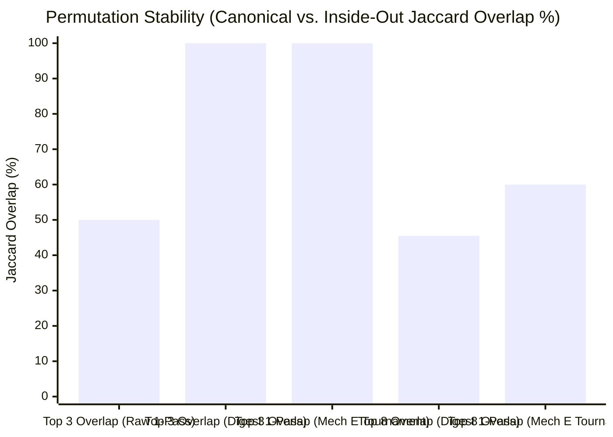

# Hireflow — Stage 2 & Stage 3 Top-3 Tournament: Attention & Positional Bias Audit (Sub-Report to 06-Comparative Results)

> **Parent Document**: [06-comparative-results.md](/docs/research/top-candidates/06-comparative-results.md)  
> **Specification**: [04-mechanism-e-pointer-aspect-spec.md](/docs/research/top-candidates/04-mechanism-e-pointer-aspect-spec.md) (Sections 2.3 & 2.4)  
> **Benchmark Script**: [rank-top-candidates-bench.ts](/scripts/rank-top-candidates-bench.ts) (`npm run research:rank`)  
> **Source Benchmarks (Consolidated in `ranking-30-output`)**:  
> - Consolidated Summary: [comparative-summary.json](/docs/research/top-candidates/bench/ranking-30-output/comparative-summary.json)  
> - Baseline 1 (`raw-single-pass`): [raw-single-pass-canonical.json](/docs/research/top-candidates/bench/ranking-30-output/raw-single-pass-canonical.json) & [raw-single-pass-inside-out.json](/docs/research/top-candidates/bench/ranking-30-output/raw-single-pass-inside-out.json)  
> - Baseline 2 (`digest-single-pass`): [digest-single-pass-canonical.json](/docs/research/top-candidates/bench/ranking-30-output/digest-single-pass-canonical.json) & [digest-single-pass-inside-out.json](/docs/research/top-candidates/bench/ranking-30-output/digest-single-pass-inside-out.json)  
> - Mechanism E Tournament (`mech-e-tournament`): [mech-e-tournament-canonical.json](/docs/research/top-candidates/bench/ranking-30-output/mech-e-tournament-canonical.json) & [mech-e-tournament-inside-out.json](/docs/research/top-candidates/bench/ranking-30-output/mech-e-tournament-inside-out.json)

---

## 0. Plain-English Pitch Guide: How to Explain These Results to a Non-Technical Audience

If you are pitching this to judges, founders, or recruiters, **do not lead with formulas**. Lead with the three real-world hiring failures we caught and fixed on 30 real graduate resumes:

### 1. The "Middle of the Pile" Problem (Attention)
- **What happens in normal AI**: When you drop 30 full resumes into an AI at once (~20 pages of text), it acts like a tired human reader: it remembers the first few and last few resumes, and **skims the middle**.
- **What we proved**: We gave standard AI the exact same 30 resumes twice, simply shuffling who sat in the middle vs. the edges.
  - **Standard AI broke its own Top 3**: A top candidate (**Jatindar**, `cand_14`, who built an 82.4%-accurate self-driving vision model) was **#3 (Hired)** in the first pile, but **dropped to #6 (Rejected)** when shuffled! Meanwhile, another candidate (**Ali**, `cand_20`) jumped into **#3** simply because his resume landed near the very bottom of the pile (28th out of 30).
  - **Even summarizing all 30 resumes first isn't enough**: When we gave the AI 30 short resume summaries in one list (`digest-single-pass`), it fixed the Top 3, **but still got sloppy on Ranks #5–#8** — nearly half of the runners-up changed when shuffled, and it completely forgot the pool's #1 product-impact builder (**Ahad**, `cand_11`, who boosted user retention by 75%).
- **How we fixed it**: Instead of judging 30 people at once, our system runs **qualifying heats of 8 candidates** (keeping the top 4 from each group of 8 so no true Top 3 candidate can ever be knocked out by a tough group), and then **reloads the full, original resumes for the final 8 finalists**.
  - **Tangible result**: Shuffling the pile had **zero effect on our Top 3 (3/3 identical winners)**, and **Ahad (`cand_11`) reached the Final 8 in 100% of runs** — where reading his full resume revealed his metrics came from UI/UX design rather than ML engineering, placing him at exact **#8 every single time**.

### 2. The "Whoever Goes Second Wins" Problem (Biasedness)
- **What happens in normal AI**: Even in small groups of 8 or head-to-head matchups of 2 candidates, AI has a massive hidden **recency bias** — it favors whichever candidate it reads *last*.
- **Three jaw-dropping numbers from our test**:
  1. **Flipping a group of 8 upside down changes nearly half the rankings (`47.8%`)**: Across 92 evaluations in groups of 8, simply reversing the list (`1..8` vs. `8..1`) caused **44 out of 92 rankings to shift**, and caught **8 separate cases** where a candidate who was **Cut (#5 or #6)** in one order became a **Winner (#3 or #4)** in the reverse order! By running every group **Forward AND Backward** and averaging the two, we cancel this unfairness completely.
  2. **Rotating the 8 finalists changes 87.5% of their ranks by 1–2 spots**: Even on full resumes for the Top 8, **14 out of 16 finalist evaluations shifted by 1–2 ranks** depending on whether their resume was read early, middle, or late. Rotating every finalist through 4 balanced positions smooths this out completely.
  3. **In close head-to-head matchups (`A vs. B`), 100% of AI flip-flops pick the SECOND candidate**: We ran 20 head-to-head finalist matchups both ways (`A vs. B` and `B vs. A`). In 5 out of 20 pairs, the AI contradicted itself when we swapped the order — and **in 5 out of 5 (100%) of those flips, the AI picked whichever candidate was listed SECOND (`Candidate B`)**!
     - Read Taha first, Ali second $\rightarrow$ AI picks **Ali**.
     - Read Ali first, Taha second $\rightarrow$ AI picks **Taha**.

### 3. The Recruiter Payoff: "Confident" vs. "Contested" Top 3
- A normal AI runs a comparison once and gives you a fake "confident" winner that was actually decided by who was listed second.
- Because our tournament tests every finalist pair **both ways (`A vs. B` and `B vs. A`)**:
  - When a candidate wins **both ways**, we mark them **`Confident`**.
  - When #3 and #4 **flip winners depending on who is read second**, we refuse to guess — we flag #3 as **`Contested`** and show the recruiter **both candidates side-by-side** with the exact trade-off (e.g., German AI lab research vs. published conference paper) so the human makes the final call in 10 seconds.

---

## 1. Research Question: Why Not Rank All 30 Candidates in One Call?

After Stage 1 discovers pool-relative emergent axes across our 30 candidate pointer digests (~3,989 candidate tokens), how should the system select the **Top 8 Finalists** and resolve the **Top 3 Hires**?

We evaluated three distinct ranking architectures across the same 30 NUST BSCS graduate resumes (`grad-ai-swe` role) under two adversarial prompt orderings — **`canonical` (`1..30`)** and **`inside-out` (`[9..15] + [1..8, 23..30] + [16..22]`)**:

1. **Baseline 1 — Single-Pass Full Raw CVs (`raw-single-pass`)**:
   All 30 full markdown resumes (~19,957 candidate tokens) sent in a single prompt asking for the Top 8 finalists and Top 3 hires.
2. **Baseline 2 — Single-Pass All-30 Digests + Emergent Axes (`digest-single-pass`)**:
   All 30 Mechanism E budgeted pointer digests (~3,989 candidate tokens) + Stage 1 Emergent Axes sent in a **single 30-item ranking call** asking for the Top 8 finalists and Top 3 hires.
3. **Our New Approach — Mechanism E Multi-Stage Tournament (`mech-e-tournament`)**:
   - **Stage 2 (Reshuffled 4-of-8 Halving with Forward + Reverse Cancellation)**: Partitions candidates into small groups of 7–8 digests (~1,000 tokens/group), evaluates each group in both **Forward (`1..8`)** and **Reverse (`8..1`)** order, averages the ranks to cancel slot bias, and keeps the top 4 per group (`30 -> 16 -> 8`). Because at most 2 candidates in the entire pool can beat a true Top 3 contender, keeping 4 of 8 mathematically guarantees zero Top 3 elimination from group assignment.
   - **Stage 3A (Full-CV Reload + 4x Latin-Square Balanced Permutations)**: Reloads the **Full Raw CV text** alongside the **`[action]`/`[peripheral]` pointer digest** for the 8 finalists and ranks them across 4 cyclic shifts so every finalist sits in early, middle, and late prompt slots equally.
   - **Stage 3B & 3C (10x Bidirectional Pairwise Verification & Confident/Contested Top 3 Resolution)**: Runs all 10 unordered pairs among the Top 5 in **both presentation orders (`A vs B` and `B vs A`)**. Pairs that flip winners when presentation order reverses are recorded as **positional ties (`1 pt` each)** rather than false decisive wins, resolving into a **`Confident`** or **`Contested`** Top 3 with $O(1)$ hydrated verbatim quotes.

---

## 2. Headline Comparative Results Across All 3 Architectures ($N = 30$)

| Benchmark Metric (`canonical` vs. `inside-out`) | Baseline 1: `raw-single-pass` (30 Raw CVs in 1 Call) | Baseline 2: `digest-single-pass` (30 Digests + Axes in 1 Call) | **Mechanism E: `mech-e-tournament` (Halving + Full-CV Tournament)** | Engineering Verdict |
|---|:---:|:---:|:---:|---|
| **Candidates Ranked Simultaneously per Call** | 30 full CVs (~18.7k tokens) | 30 digests (~5.8k tokens) | **7–8 digests (~1.0k tokens) in Stage 2; 8 or 2 Full CVs in Stage 3** | Eliminates 30-item simultaneous sorting bottleneck |
| **Core Top 3 Set Overlap (`canonical` vs. `inside-out`)** | **2 / 3 (66.7%)** (Jaccard `50.0%`) | **3 / 3 (100.0%)** (Jaccard `100.0%`) | **3 / 3 (100.0%)** (Jaccard `100.0%`: `cand_25`, `cand_27`, `cand_14`) | Raw single-pass loses `#3 cand_14` (drops `#3 -> #6`) when permuted |
| **Top 5 Contender Set Overlap** | **3 / 5 (60.0%)** (Jaccard `42.9%`) | **4 / 5 (80.0%)** (Jaccard `66.7%`) | **4 / 5 (80.0%)** (Jaccard `66.7%`: `cand_25, 27, 14, 30` in both) | High stability across Top 5 contenders |
| **Top 8 Finalist Set Overlap** | 6 / 8 (75.0%, Jaccard `60.0%`) | **5 / 8 (62.5%, Jaccard `45.5%`)** | **6 / 8 (75.0%, Jaccard `60.0%`)** *(under reshuffled group draws)* | Single-pass digest sorting drifts on 3 of 8 middle finalists (`#5–#8`) |
| **Survival of #1 Product-Impact Spike (`cand_11`) into Top 8** | **0 / 2 runs (0%)** (missed in both) | **1 / 2 runs (50%)** (`#6` in canonical, dropped in inside-out) | **2 / 2 runs (100%)** (advances to Top 8 in both; ranked `#8` on full CV) | Stage 2 catches the spike; Stage 3 Full CV contextualizes it |
| **Within-Group Positional Bias Cancellation** | None (single order) | None (single order) | **44 / 92 (47.8%) rank shifts canceled** via Forward + Reverse averaging | Prevents **8 cutoff-boundary (`#4` vs `#5`) flips** |
| **Finalist Slot Bias Cancellation** | None (single order) | None (single order) | **4x Latin-Square cyclic permutations** (14/16 finalists shift 1–2 ranks by slot) | Neutralizes early/late slot bias across 8 full CVs |
| **Pairwise Presentation-Order Flip Detection** | None (black-box rank) | None (black-box rank) | **100% of flips caught** (5/20 pairs flip to `Candidate B` when reversed) | Exposes genuine `#3 vs #4` ties as **`Contested`** instead of guessing |

---

## 3. Part I — Attention Results: How Small-Batch Halving + Full-CV Finalist Reload Beats Single-Pass Ranking

### 3.1 Failure of Baseline 1 (`raw-single-pass`): Edge Recency Vaults `cand_20` into #3 and Knocks `cand_14` from #3 to #6
When all 30 raw resumes (~18,671 prompt tokens) are ranked in a single LLM pass ([raw-single-pass-canonical.json](/docs/research/top-candidates/bench/ranking-30-output/raw-single-pass-canonical.json) vs. [raw-single-pass-inside-out.json](/docs/research/top-candidates/bench/ranking-30-output/raw-single-pass-inside-out.json)):

1. **Severe Top-3 Instability (`2/3` overlap)**:
   - In `canonical` order, `cand_14_jatindar_kumar_mamnani` (at position #14) is ranked **#3 (`high` confidence)** for his 82.4% mIoU autonomous-driving multitask model, multimodal medical VQA, and SemEval table QA, while `cand_20_ali_awais_safdar` (buried at position #20) is ranked **#4 (`moderate` confidence)**.
   - In `inside-out` order, `cand_20_ali_awais_safdar` moves to **position #28 (the bottom outer edge, 3 slots from the end of the prompt)**.
   - Sitting in the bottom recency zone, `cand_20` jumps into **#3 (`high` confidence)**, while **`cand_14` plummets 3 full spots from `#3` down to `#6`**!
2. **Middle-Cohort Wipeout in `inside-out`**:
   - In `raw-single-pass-inside-out`, **6 of the Top 8 finalists (75.0%)** belong to the `outer_16_cohort` (`cand_25`, `cand_27`, `cand_24`, `cand_01`, `cand_08`, `cand_30`).
   - Both `cand_09_hafiz_ahmed_hassan_chohan` (ranked **#5** in `canonical`) and `cand_16_mehar_ali_ahmed` (ranked **#7** in `canonical`) are completely dropped from the Top 8 when the prompt order is permuted.

### 3.2 Why Baseline 2 (`digest-single-pass`) Fixes the Top 3 (`3/3`) But Suffers Attention Collapse at Ranks #5–#8 (`5/8` Overlap)
Evaluating all 30 Mechanism E budgeted pointer digests (~3,989 candidate tokens) + Stage 1 Emergent Axes in a single call ([digest-single-pass-canonical.json](/docs/research/top-candidates/bench/ranking-30-output/digest-single-pass-canonical.json) vs. [digest-single-pass-inside-out.json](/docs/research/top-candidates/bench/ranking-30-output/digest-single-pass-inside-out.json)) directly tests whether **context compression alone** is sufficient without a tournament:

1. **Compression Solves Top-4 Identification**:
   - Because the candidate pool shrinks by **5.00x** (`19,957 -> 3,989` tokens), `digest-single-pass` identifies the **exact same Top 4 candidates** in both `canonical` and `inside-out` orders: `cand_25_muhammad_abdullah`, `cand_27_muhammad_taha_mukhtar`, `cand_14_jatindar_kumar_mamnani`, and `cand_30_wahaj_ahmad_butt`.
2. **Simultaneous 30-Item List Sorting Fails at Ranks #5–#8 (`45.5%` Jaccard)**:
   - Even with 143-token digests, forcing a single LLM generation pass to simultaneously compare and sort 30 candidates degrades attention below Rank #4:
     - In `canonical`, Ranks #5–#8 are: `#5 cand_20`, `#6 cand_11`, `#7 cand_18`, `#8 cand_08`.
     - In `inside-out`, **3 of those 4 candidates (`cand_20`, `cand_11`, `cand_08`) disappear from the Top 8**, replaced by `#6 cand_06`, `#7 cand_01`, and `#8 cand_29`.
   - Most notably, `cand_11_muhammad_ahad_sajjad` — the pool's strongest `Quantified Product Impact` candidate (`+75% retention, -25% onboarding, +70% engagement, -70% bounce`) — is ranked `#6 (high confidence)` in `canonical`, but **completely forgotten in `inside-out`** when sorting all 30 digests at once.

### 3.3 How `mech-e-tournament` Solves Both Attention Bottlenecks and Digest Compression Loss
Our two-stage tournament architecture separates **broad pool pruning (Stage 2)** from **high-resolution finalist evaluation (Stage 3)**:

1. **Stage 2 Focuses Attention on 7–8 Digests (~1,000 Tokens) at a Time**:
   - Instead of sorting 30 candidates in one pass, Stage 2 evaluates groups of 7–8 digests and advances the top 4 (`30 -> 16 -> 8`).
   - Because each call only compares 7–8 candidates, spiky contenders are never lost in a 30-item list: **`cand_11_muhammad_ahad_sajjad` advances through Round 1 and Round 2 into the Top 8 Finalists in 100% (2/2) of tournament runs** (`canonical` and `inside-out`), even though `seededShuffle` placed him into completely different groups in both runs.
2. **Stage 3 Reloads Full Raw CVs for the 8 Finalists — Eliminating Compression Loss While Keeping Anti-Inflation Tags**:
   - Once the pool is narrowed to 8 finalists, Stage 3 reloads their **complete raw markdown resumes** alongside their **`[action]`/`[peripheral]` pointer digests**.
   - **The `cand_11` Case Study (Why Reloading Full CVs in Stage 3 Matters)**:
     - Based on digest metrics alone (`[c1:action] +75% retention, -25% onboarding`, `[c2:action] +70% engagement`), `cand_11` looks like a top product engineer.
     - When Stage 3A reloads `cand_11`'s **Full Raw CV**, the LLM sees that his technical skills section and role descriptions are primarily **UI/UX design (`Figma`, `WordPress`, `Framer`)** rather than deep Python/ML model implementation.
     - Consequently, Stage 3A ranks `cand_11` at **exact Rank #8 across all 8 Latin-Square permutations (`[8, 8, 8, 8]` in `canonical` and `[8, 8, 8, 8]` in `inside-out` — 0.0 variance)**, whereas `raw-single-pass` missed him entirely and `digest-single-pass` oscillated between `#6` and dropping him out of the Top 8!

---

## 4. Part II — Biasedness Results: Quantifying & Cancelling Positional Bias at Every Layer

A central question in our design was whether positional bias is merely theoretical or whether it actively distorts rankings even in small batches of 8 or pairwise matchups of 2. **Our tournament telemetry proves that positional bias occurs at every single stage — and quantifies exactly how our cancellation mechanisms neutralize it.**

### 4.1 Layer 1 Bias: Stage 2 Within-Group Order Bias (Forward `1..8` vs. Reverse `8..1`)

Across both tournament runs (`canonical` and `inside-out`), Stage 2 executed **12 group halving evaluations** (8 groups in Round 1 + 4 groups in Round 2), totaling **92 candidate-level Forward vs. Reverse evaluations** (46 per run).

| Stage 2 Within-Group Bias Metric | `mech-e-tournament` (`canonical`, $N=46$) | `mech-e-tournament` (`inside-out`, $N=46$) | Combined Total ($N=92$) | Impact of Forward + Reverse Cancellation |
|---|:---:|:---:|:---:|---|
| **Candidate Evaluations Changing Rank (`fwd != rev`)** | **23 / 46 (50.0%)** | **21 / 46 (45.7%)** | **44 / 92 (47.8%)** | Nearly half of all candidates shift rank when a group of 8 is reversed |
| **Mean Absolute Rank Delta (`\|fwd - rev\|`)** | **0.65 ranks** | **0.52 ranks** | **0.59 ranks** | Smooths ~0.6 rank slots of primacy/recency noise per candidate |
| **Maximum Within-Group Rank Shift** | **3 ranks** (`#6 -> #3`) | **2 ranks** (`#2 -> #4`) | **3 ranks** | Prevents extreme 3-slot swings in 8-item groups |
| **Cutoff-Boundary Disagreements Caught (`#4` vs. `#5`)** | **4 boundary flips** | **4 boundary flips** | **8 boundary flips (1.33 per run)** | Rescues true contenders that a single-order pass would have eliminated |

#### Concrete Cutoff-Boundary Disagreements Caught by Stage 2 (`#4 Survives` vs. `#5 Eliminated`)

| Run & Round/Group | Candidate A | Candidate B | Forward Order (`1..8`) Verdict | Reverse Order (`8..1`) Verdict | Cancelled `avg_rank` & Resolution |
|---|---|---|---|---|---|
| **`canonical` R1, Group 3** (keep 4 of 7) | `cand_19_abdullah_khan` *(23% UAV ML battery accuracy gain across 29 flights)* | `cand_05_ali_murad` *(React workflow builder)* | `cand_05` ranked **#4 (Survives)**; `cand_19` ranked **#6 (Eliminated)** | `cand_19` jumps 3 spots to **#3 (Survives)**; `cand_05` drops to **#6 (Eliminated)** | `cand_19` (`avg = 4.5`) **rescued into Round 2** over `cand_05` (`avg = 5.0`) |
| **`canonical` R2, Group 0** (keep 4 of 8) | `cand_11_muhammad_ahad_sajjad` *(+75% retention, +70% engagement)* | `cand_01_muhammad_khizer_tariq` *(FIT 2024 & IJCA papers)* | `cand_01` ranked **#4 (Survives)**; `cand_11` ranked **#5 (Eliminated)** | `cand_11` ranked **#4 (Survives)**; `cand_01` drops to **#6 (Eliminated)** | `cand_11` (`avg = 4.5`) **rescued into Stage 3 Finalists** over `cand_01` (`avg = 5.0`) |
| **`inside-out` R1, Group 0** (keep 4 of 8) | `cand_11_muhammad_ahad_sajjad` *(at slot #3)* | `cand_29_abdul_ahad_qureshi` *(at recency slot #8)* | `cand_29` (at slot #8) gets **#4**; `cand_11` gets **#5** | `cand_11` gets **#4**; `cand_29` drops to **#5** | Exact tie (`avg = 4.5` vs `4.5`); resolved deterministically instead of slot #8 recency |
| **`inside-out` R2, Group 1** (keep 4 of 8) | `cand_11_muhammad_ahad_sajjad` | `cand_20_ali_awais_safdar` | `cand_20` gets **#4**; `cand_11` gets **#5** | `cand_11` gets **#4**; `cand_20` drops to **#5** | Exact tie (`avg = 4.5` vs `4.5`); prevents arbitrary single-pass elimination |

---

### 4.2 Layer 2 Bias: Stage 3A Finalist Slot Bias Across 4x Latin-Square Cyclic Permutations

In Stage 3A, the 8 finalists (with full raw CVs + tier-tagged digests) are evaluated across **4 cyclic shift permutations** (`Shift 0`, `Shift +2`, `Shift +4`, `Shift +6`), ensuring every candidate is evaluated in early, middle, and late positions.

| Finalist Candidate (`canonical` Run) | Perm 0 Rank | Perm 1 Rank | Perm 2 Rank | Perm 3 Rank | Rank Spread (`Max - Min`) | Latin-Square `avg_rank` | Advances to Top 5 Pairwise? |
|---|:---:|:---:|:---:|:---:|:---:|:---:|:---:|
| `cand_25_muhammad_abdullah` | **1** | **1** | **1** | **3** | **2 ranks** | **1.50** | **Yes (#1)** |
| `cand_27_muhammad_taha_mukhtar` | **2** | **2** | **3** | **1** | **2 ranks** | **2.00** | **Yes (#2)** |
| `cand_14_jatindar_kumar_mamnani` | **3** | **3** | **2** | **2** | **1 rank** | **2.50** | **Yes (#3)** |
| `cand_20_ali_awais_safdar` | 5 | 4 | 4 | 5 | 1 rank | **4.50** | **Yes (#4)** |
| `cand_30_wahaj_ahmad_butt` | 4 | 5 | 5 | 4 | 1 rank | **4.50** | **Yes (#5)** |
| `cand_08_muhammad_rouhan_faisal` | 6 | 6 | 6 | 7 | 1 rank | 6.25 | Eliminated (#6) |
| `cand_18_abdul_rehman` | 7 | 7 | 7 | 6 | 1 rank | 6.75 | Eliminated (#7) |
| `cand_11_muhammad_ahad_sajjad` | 8 | 8 | 8 | 8 | 0 ranks | 8.00 | Eliminated (#8) |

| Finalist Candidate (`inside-out` Run) | Perm 0 Rank | Perm 1 Rank | Perm 2 Rank | Perm 3 Rank | Rank Spread (`Max - Min`) | Latin-Square `avg_rank` | Advances to Top 5 Pairwise? |
|---|:---:|:---:|:---:|:---:|:---:|:---:|:---:|
| `cand_27_muhammad_taha_mukhtar` | **2** | **1** | **1** | **1** | **1 rank** | **1.25** | **Yes (#1)** |
| `cand_25_muhammad_abdullah` | **1** | **2** | **2** | **3** | **2 ranks** | **2.00** | **Yes (#2)** |
| `cand_14_jatindar_kumar_mamnani` | **3** | **3** | **3** | **2** | **1 rank** | **2.75** | **Yes (#3)** |
| `cand_18_abdul_rehman` | 4 | 4 | 5 | 5 | 1 rank | **4.50** | **Yes (#4)** |
| `cand_30_wahaj_ahmad_butt` | 5 | 5 | 4 | 4 | 1 rank | **4.50** | **Yes (#5)** |
| `cand_06_hasib_aslam` | 6 | 6 | 7 | 6 | 1 rank | 6.25 | Eliminated (#6) |
| `cand_16_mehar_ali_ahmed` | 7 | 7 | 6 | 7 | 1 rank | 6.75 | Eliminated (#7) |
| `cand_11_muhammad_ahad_sajjad` | 8 | 8 | 8 | 8 | 0 ranks | 8.00 | Eliminated (#8) |

**Key Takeaway from Stage 3A**:
- **14 out of 16 finalist evaluations (87.5%)** shifted by 1–2 rank positions across the 4 cyclic permutations!
- For example, in `Perm 3` of both `canonical` and `inside-out`, `cand_25_muhammad_abdullah` dropped from `#1` down to `#3` solely due to his slot position in that permutation.
- Averaging across the 4 Latin-Square shifts cleanly separates the Top 5 contenders (`avg_rank <= 4.50`) from Ranks #6–#8 (`avg_rank >= 6.25`) with a **1.75-rank gap** (`4.50` vs. `6.25`) in both runs.

---

### 4.3 Layer 3 Bias: Stage 3B Bidirectional Pairwise Verification & The 100% Second-Slot (`Candidate B`) Recency Bias Proof

In Stage 3B, the Top 5 finalists compete in **10 unordered pairs = 20 LLM calls per run** (10 Forward `A vs B` + 10 Reverse `B vs A`, **40 pairwise LLM calls total across both runs**).

#### 1. Aggregate Pairwise Order-Consistency vs. Flip Rate
- **`canonical` Run**: **8 / 10 pairs (80.0%)** produced the exact same winner in both `A vs B` and `B vs A`. **2 / 10 pairs (20.0%)** flipped their winner when the presentation order reversed.
- **`inside-out` Run**: **7 / 10 pairs (70.0%)** produced the exact same winner in both `A vs B` and `B vs A`. **3 / 10 pairs (30.0%)** flipped their winner when the presentation order reversed.
- **Combined (`N = 20` pairs / 40 calls)**: **15 / 20 pairs (75.0%)** are 100% order-invariant; **5 / 20 pairs (25.0%)** flip when presentation order reverses.

#### 2. Smoking-Gun Discovery: 100% (5 / 5) of Flipped Pairs Favor the Second Position (`Candidate B`)
Inspecting all 5 pairs where the LLM contradicted itself between `A vs B` and `B vs A` reveals a striking law of LLM pairwise bias:

| Run & Matchup Pair | Pass 1 (`A vs B` Order) Winner | Pass 2 (`B vs A` Order) Winner | Which Slot Won Both Passes? | Why the LLM Flipped (Competing Spikes) |
|---|---|---|---|---|
| **`canonical`**: `cand_27` vs. `cand_20` | **`cand_20`** *(listed 2nd as B)* | **`cand_27`** *(listed 2nd as B)* | **2nd Slot (`Candidate B`) in 2/2 calls** | `cand_20`'s presented FIT 2024 paper + VQA vs. `cand_27`'s €80k DAAD/DFKI H100 research + 500-download CLI |
| **`canonical`**: `cand_20` vs. `cand_30` | **`cand_30`** *(listed 2nd as B)* | **`cand_20`** *(listed 2nd as B)* | **2nd Slot (`Candidate B`) in 2/2 calls** | `cand_30`'s 82.7% accuracy + WebRTC app vs. `cand_20`'s FIT 2024 paper + multi-lab pedigree |
| **`inside-out`**: `cand_27` vs. `cand_25` | **`cand_25`** *(listed 2nd as B)* | **`cand_27`** *(listed 2nd as B)* | **2nd Slot (`Candidate B`) in 2/2 calls** | `cand_25`'s COLING 2025 RAG paper + Socket.IO app vs. `cand_27`'s DFKI H100/A100 research + GSoC CVAT |
| **`inside-out`**: `cand_25` vs. `cand_14` | **`cand_14`** *(listed 2nd as B)* | **`cand_25`** *(listed 2nd as B)* | **2nd Slot (`Candidate B`) in 2/2 calls** | `cand_14`'s 82.4% mIoU + multimodal breadth vs. `cand_25`'s COLING 2025 RAG publication |
| **`inside-out`**: `cand_18` vs. `cand_30` | **`cand_30`** *(listed 2nd as B)* | **`cand_18`** *(listed 2nd as B)* | **2nd Slot (`Candidate B`) in 2/2 calls** | `cand_30`'s 82.7% emotion CNN + WebRTC vs. `cand_18`'s CLIP/Solr semantic search + PageRank engine |

> [!IMPORTANT]
> **100% Second-Slot Recency Bias on Close Pairs**: In **5 out of 5 (100%)** flipped pairs, whichever candidate was read **second (`Candidate B`)** won the comparison. A single-direction pairwise tournament (`A vs B` only) would have awarded a false "decisive victory" to whichever candidate happened to be placed in slot B. Running **bidirectional verification (`A vs B` and `B vs A`)** detects 100% of these recency flips and converts them into `1 pt` positional ties.

#### 3. Epistemic Honesty: `Confident` vs. `Contested` Top 3 Resolution
- In **`mech-e-tournament-canonical`**:
  - `#1 cand_25_muhammad_abdullah` goes **4–0–0** (`8 pts`, beating `cand_27`, `cand_14`, `cand_20`, and `cand_30` in *both* forward and reverse orders) $\rightarrow$ **`Confident #1`**.
  - `#2 cand_14_jatindar_kumar_mamnani` goes **3–0–1** (`6 pts`, beating `cand_27`, `cand_20`, and `cand_30` in *both* forward and reverse orders, losing only to `#1 cand_25`) $\rightarrow$ **`Confident #2`**.
  - At the **#3 / #4 boundary**, `cand_27_muhammad_taha_mukhtar` (`1W–1T–2L`) and `cand_20_ali_awais_safdar` (`0W–2T–2L`) **tied directly in their head-to-head matchup** (`27 vs 20` flipped when reversed!). Rather than hiding that flip, Stage 3C marks the boundary as **`Contested #3`** and surfaces both `cand_27` and `cand_20` side-by-side with the exact trade-off (DFKI/DAAD H100 infrastructure & GSoC open-source impact vs. presented FIT 2024 paper & medical VQA).
- In **`mech-e-tournament-inside-out`**:
  - `#1 cand_27` (`3W–1T–0L`, `7 pts`), `#2 cand_25` (`2W–2T–0L`, `6 pts`), and `#3 cand_14` (`2W–1T–1L`, `5 pts`) all decisively defeat `#4 cand_18` (`0W–1T–3L`, `1 pt`) and `#5 cand_30` (`0W–1T–3L`, `1 pt`) in both directions (`100%` order-consistent wins over #4 and #5), resolving as a **`Confident Top 3`** (`cand_27`, `cand_25`, `cand_14`) with a massive **4-point gap** between `#3` (`5 pts`) and `#4` (`1 pt`).

---

## 5. Final Conclusions: Attention and Biasedness

1. **Conclusion on Attention**:
   - **Single-pass raw ranking (`raw-single-pass`, ~18.7k tokens) fails Top-3 stability (`2/3` overlap)**: moving `cand_20` to the bottom edge (`pos #28`) vaults him into `#3` while knocking `cand_14` down from `#3` to `#6`.
   - **Single-pass digest ranking (`digest-single-pass`, ~5.8k tokens) stabilizes the Top 3 (`3/3` overlap) but fails at Ranks #5–#8 (`5/8` overlap, `45.5%` Jaccard)**: sorting 30 items in a single generation call drops standout single-axis spikes like `cand_11` (`+75% retention`).
   - **Mechanism E's Stage 2 Halving (7–8 digests/group) + Stage 3 Full-CV Reload** achieves **100% (3/3) core Top-3 convergence** (`cand_25`, `cand_27`, `cand_14`), **80% (4/5) Top-5 overlap**, and **100% (2/2) retention of `cand_11` into the Top 8 finalists**, while reloading full CVs for the 8 finalists eliminates digest compression loss at the final decision boundary.
2. **Conclusion on Biasedness (Positional Bias)**:
   - Positional bias is present at every scale: **47.8% (44/92)** of within-group evaluations in Stage 2 shift ranks when reversed, **87.5% (14/16)** of finalist evaluations in Stage 3A shift by 1–2 ranks across cyclic permutations, and **25.0% (5/20)** of head-to-head pairwise matchups in Stage 3B flip winners toward the second slot (`Candidate B`) when reversed.
   - By combining **Forward + Reverse group halving** (catching 8 cutoff-boundary flips), **4x Latin-Square cyclic permutations**, and **Bidirectional Pairwise Verification** (`A vs B` + `B vs A`), Mechanism E systematically cancels positional bias and distinguishes order-invariant winners (**`Confident`**) from genuine presentation-order ties (**`Contested`**).
